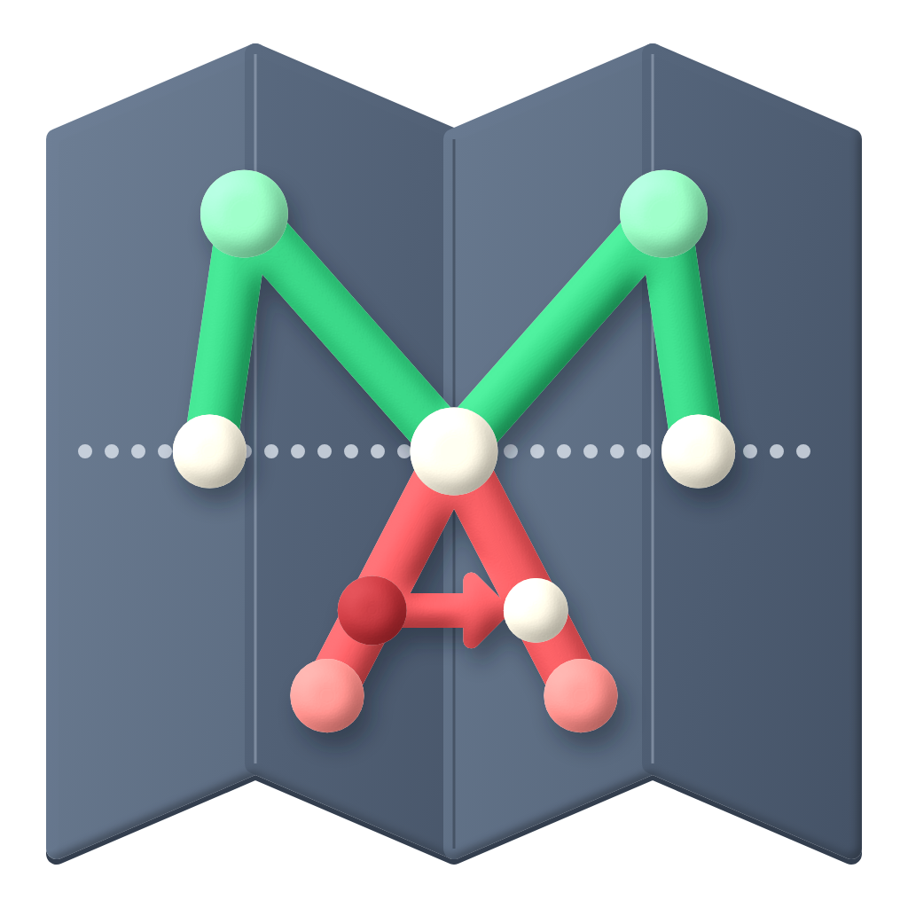
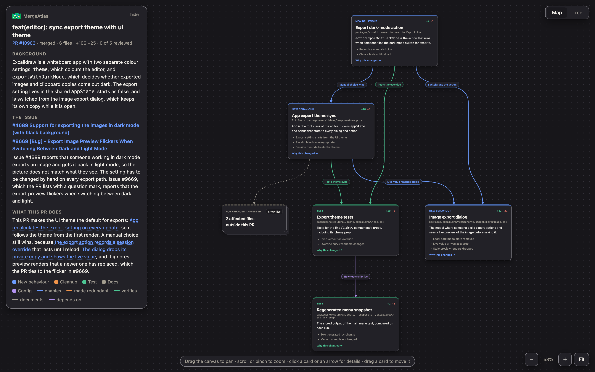
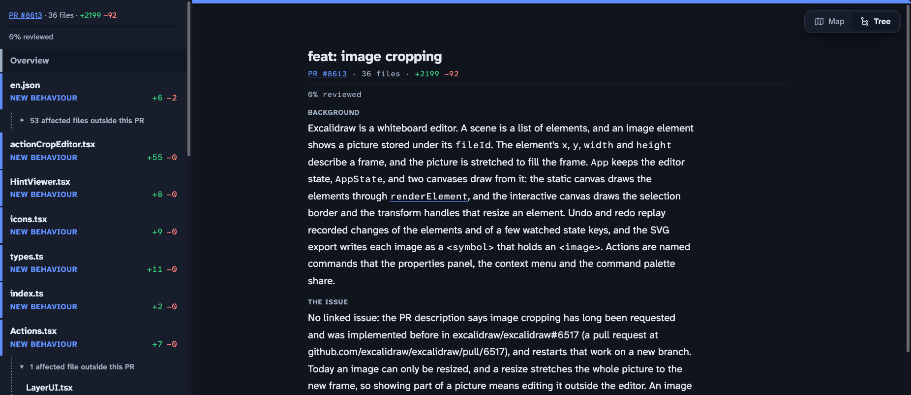

<p align="center"></p>

<h1 align="center">MergeAtlas</h1>

<p align="center"><strong>Know what you're approving for real</strong></p>

<p align="center"><a href="https://mergeatlas.dev">mergeatlas.dev</a></p>





<p align="center"><sub>MergeAtlas mapping <a href="https://github.com/excalidraw/excalidraw/pull/8613">excalidraw/excalidraw#8613</a>, which adds image cropping to the editor.</sub></p>

## What is MergeAtlas?

A pull request arrives as a wall of lines, all the same green. MergeAtlas is an agent skill that turns it into an interactive map on localhost, so you start from what the change is for and what it reaches, before you read a line.

It's made for changes that reach past their diff, even in code you know well: several files, some of them affected only indirectly.

The context comes first: how this part of the project works today, the problem, and what the pull request does about it. The changed files sit in groups that change for the same reason, and arrows run from each cause to its effect, including into files the pull request never touches.

When agents write the code, much of a large change is wiring. You go straight to the lines that change how things behave, and the rest is there when you want it.

It works beside the diff, not instead of it: every claim links to the lines it comes from. And it stops at understanding. It won't hunt for bugs or approve for you; the judgement stays yours.

## Features

- **Map view:** an infinite canvas of cards and cause-and-effect arrows that you can pan, zoom and rearrange.
- **Groups:** cards sit in a frame per intent, the outcome they serve, ordered so arrows run left to right. Arrows take the direct way between cards, and hovering a card highlights its own.
- **Atlas zoom:** zoom out and cards turn compact, then each group becomes one block with its title and progress.
- **Compact and Detailed:** switch cards between a one-line summary and the full story of the change.
- **Tree view:** a collapsible outline of the same cards and their affected files, with keyboard navigation.
- **The story:** background, problem and what the pull request does, in plain words, linked to the cards that did each part.
- **Changes:** a card steps through its changes one at a time, each with its problem, what changes, its key lines and why that fixes it.
- **Affected files:** unchanged files that behave differently because of the pull request sit in a stack beside the card that reaches them.
- **Tests and no-behaviour-change files:** tests stack beside the card they verify, and whitespace, formatting, renames and generated files stack apart with a reason each, so your attention goes to what matters.
- **Code links:** claims link to their lines, in the pull request's Files changed tab or at the head commit.
- **Review marks:** mark a file as reviewed and go straight to the next one. A progress bar counts the files that matter, and Previous and Next step through reading order.
- **Jump to a file:** press ⌘K, or Ctrl K, to find a file by name.
- **Share:** download the map as one HTML file that opens in any browser, with no MergeAtlas or setup.
- **Light and dark themes:** the viewer follows your system setting.

### Tickets

GitHub issues linked to the pull request work out of the box. For other trackers, MergeAtlas spots the ticket in the pull request's title, description or branch name, and your agent reads it through the connection it already has, such as an MCP server. MergeAtlas stores no tracker credentials of its own.

It recognises links from Jira, Linear, Trello, Asana, Shortcut, ClickUp and Azure Boards, and bare keys like `ENG-123`. If your agent can't reach the tracker, it tells you which ticket it couldn't read and builds the map from the pull request alone.

## Running it

You'll need:

- An agent that runs skills, such as Claude Code or Codex
- Python 3
- `git`
- The [GitHub CLI](https://cli.github.com), signed in with `gh auth login`

### Claude Code

Add this repository as a plugin marketplace, then install the plugin:

```
/plugin marketplace add ismayilkarimli/MergeAtlas
```

```
/plugin install mergeatlas@mergeatlas
```

Plugin skills carry the plugin's name, so the command is `/mergeatlas:mergeatlas`. Asking your agent to map a pull request works too. To update, run `/plugin marketplace update mergeatlas`.

### Other agents, such as Codex

Install the skill with [skills.sh](https://skills.sh). It finds your agents and puts the skill where each looks:

```bash
npx skills add ismayilkarimli/MergeAtlas
```

Add `-a codex` to install for Codex only, and `-g` to install for every project instead of the current one.

### By hand

Clone the repository and link the skill into your skills folder:

```bash
git clone https://github.com/ismayilkarimli/MergeAtlas.git
```

```bash
ln -s "$PWD/MergeAtlas/skills/mergeatlas" ~/.claude/skills/mergeatlas
```

This is the setup where `/mergeatlas` works without the plugin's prefix.

### Using it

From inside the pull request's repository, ask your agent to map it. The map opens at `http://127.0.0.1:8765`.

### Choosing the cold readers' model

Before publishing, your agent hands each card to a fresh subagent that has never seen the project, to find what the card leaves unexplained. The defaults for that subagent are Sonnet 5.5 at medium effort in Claude Code, Sol 6.1 at medium effort in Codex, and your agent's own model anywhere else.

On the first run, your agent asks which model to use, with the default already selected, so pressing Enter keeps it. Your answer is saved to `~/.config/mergeatlas/config.json` (or under `$XDG_CONFIG_HOME`). To use another model for a single run, say so when you ask, such as "map this PR using Haiku 5.5 high"; the saved choice stays as it was.

To change the saved choice later, ask your agent, such as "set MergeAtlas's cold readers to Opus 5.5 high", or "show MergeAtlas's cold reader model" to see what applies. You can also edit the file directly. Under `cold_read`, the entries are `claude-code`, `codex`, and `default` for any other agent, and each entry replaces only the settings it names. An empty model means your agent's own model. For example:

```json
{
  "cold_read": {
    "claude-code": {"model": "Opus 5.5", "effort": "high"},
    "codex": {"effort": "low"},
    "default": {"model": "DeepSeek-v4.1-Flash-1017"}
  }
}
```

## How it works

The analysis comes from your agent, which reads the issue, the diff and the surrounding source. `skills/mergeatlas/scripts/mergeatlas.py` does the mechanical part: it fetches the pull request, runs the searches your agent chooses for affected files, checks the map against the diff, and serves it. Those searches are plain text, so MergeAtlas works in any language. Maps and working files stay on your machine in `~/.cache/mergeatlas`.

## License

[MIT](LICENSE)
