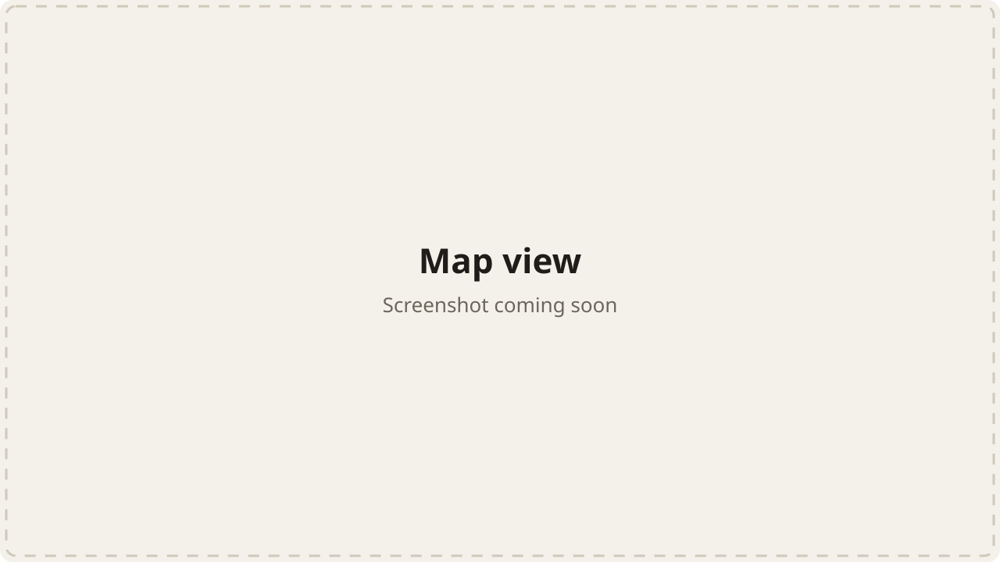
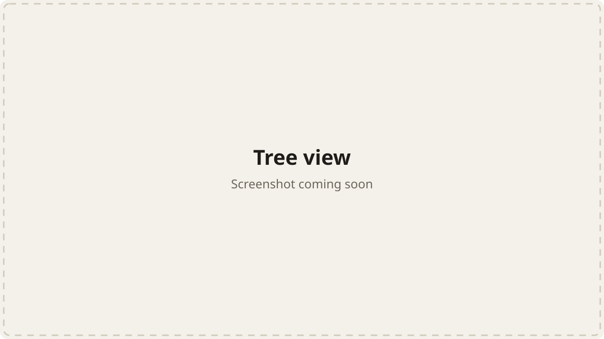

<p align="center"></p>

<h1 align="center">MergeAtlas</h1>

<p align="center"><strong>Review code you don't know</strong></p>

<p align="center"><a href="https://mergeatlas.dev">mergeatlas.dev</a></p>





## What is MergeAtlas?

When you're asked to review a large change in a project you don't know well, MergeAtlas helps you quickly build the mental model you're missing. You can give a real review without having to reconstruct the change and hold it all in your head.

It's an agent skill that turns a pull request into an interactive map on localhost. The story of the change comes first: what this part of the project does, the problem, and what the PR does about it. Each changed component is a card, and arrows show how a change in one reaches another, including through files the PR never touches. The map stops at understanding, so it doesn't find bugs, give verdicts, or tell you what to do. Those stay with you.

## Features

- **Map view:** an infinite canvas of cards and cause-and-effect arrows that you can pan, zoom and rearrange.
- **Tree view:** a collapsible outline of the same cards and their affected files, with keyboard navigation.
- **The story:** background, problem and solution in plain words, linked to the cards that did each part.
- **Affected files:** unchanged files that behave differently because of the PR sit in a stack beside the card that reaches them.
- **Key lines:** the lines most worth your attention on each card, and why they matter.
- **Code links:** claims link to their lines, in the PR's Files changed tab or at the head commit.
- **Review marks:** mark cards as reviewed as you go, and see your progress across the PR.
- **Light and dark themes:** the viewer follows your system setting.

### Tickets

GitHub issues linked to the PR work out of the box. For other trackers, MergeAtlas spots the ticket in the PR's title, description or branch name, and your agent reads it through the connection it already has, such as an MCP server. MergeAtlas stores no tracker credentials of its own.

It recognises links from Jira, Linear, Trello, Asana, Shortcut, ClickUp and Azure Boards, and bare keys like `ENG-123`. If your agent can't reach the tracker, it tells you which ticket it couldn't read and builds the map from the PR alone.

## Running it

You'll need:

- An agent that runs skills, such as Claude Code
- Python 3
- `git`
- The [GitHub CLI](https://cli.github.com), signed in with `gh auth login`

Clone the repository and link the skill into your skills folder:

```bash
git clone https://github.com/ismayilkarimli/MergeAtlas.git
```

```bash
ln -s "$PWD/MergeAtlas/skills/mergeatlas" ~/.claude/skills/mergeatlas
```

Then, from inside the PR's repository, ask your agent to map it, or run `/mergeatlas` in Claude Code. The map opens at `http://127.0.0.1:8765`.

## How it works

The analysis comes from your agent, which reads the issue, the diff and the surrounding source. `skills/mergeatlas/scripts/mergeatlas.py` does the mechanical part: it fetches the PR, lists the candidates for reach, checks the map against the diff, and serves it. Maps and working files stay on your machine in `~/.cache/mergeatlas`.

## License

[MIT](LICENSE)
